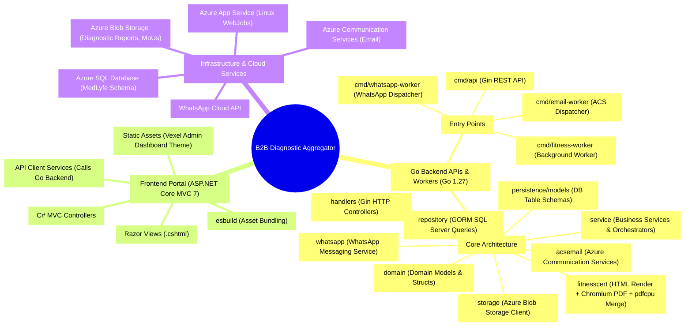
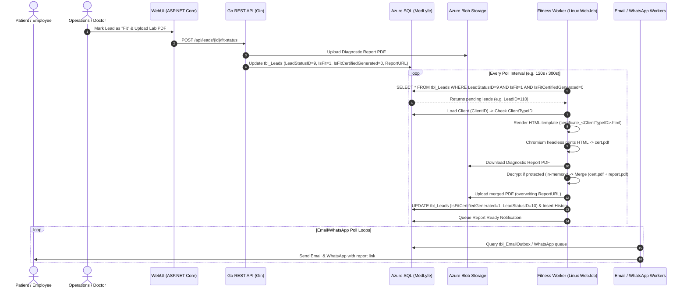

# B2B Diagnostic Aggregator — Project Context & System Architecture

> **Notice for AI Assistants & Automated Tools:**  
> This file is the primary context and architectural reference for the **B2B Diagnostic Aggregator** repository. Read this file before making modifications across any API, Worker, WebUI, database repository, or deployment script.

---

## 1. Executive Summary & Business Domain

The **B2B Diagnostic Aggregator** is an enterprise healthcare diagnostic platform designed to aggregate diagnostic laboratory workflows, corporate employee health checks, collection stores, and patient reporting into a unified system.

Key functionalities include:
- **Corporate Client & Employee Management:** Onboarding corporate clients, scheduling employee diagnostic appointments, managing packages and tests.
- **Lead Lifecycle Management:** Tracking patient leads from creation through sample collection, lab processing, diagnostic report upload, doctor fitness evaluation, and final delivery.
- **Automated Fitness Certification:** For eligible corporate clients (e.g. food handling, logistics, factory workforce), a background worker automatically renders a client-specific fitness certificate, downloads the lab diagnostic report PDF from Azure Blob Storage, prepends the fitness certificate as Page 1, and saves the consolidated PDF back to storage.
- **Omnichannel Notifications:** Dispatches transactional emails via **Azure Communication Services (ACS)** and WhatsApp notifications via **WhatsApp Cloud / Business API**.
- **Role-Based Web Portals:** An **ASP.NET Core MVC** web interface used by corporate clients, operations administrators, collection stores, and labs.

---

## 2. System Architecture Mind Map



---

## 3. High-Level Component Interaction Flow



---

## 4. Directory Structure & Responsibilities

```text
B2B-Aggregator/
├── B2B-Aggregator-APIs/                 # Go backend module (apis)
│   ├── cmd/
│   │   ├── api/                         # REST API entry point (Gin)
│   │   ├── fitness-worker/              # Fitness Certificate & PDF Merge background worker
│   │   ├── email-worker/                # Email outbox processor (Azure Communication Services)
│   │   └── whatsapp-worker/             # WhatsApp messaging background worker
│   ├── docs/                            # In-depth architectural & deployment markdown docs
│   ├── scripts/                         # Build, deployment & SQL maintenance scripts
│   │   ├── deploy-all-workers.sh        # Builds all 3 workers & bundles Linux WebJobs zip
│   │   └── bundle-chrome-linux-deps.sh  # Bundles shared system libraries for headless Chromium
│   └── src/                             # Go source root (module: b2b-diagnostic-aggregator/apis)
│       ├── chrome-linux64/              # Bundled Linux Chromium binary for App Service
│       ├── chrome-linux-deps/           # Bundled shared libraries (.so) for Chromium
│       ├── templates/                   # HTML certificate templates (certificate_1.html, etc.)
│       ├── go.mod / go.sum              # Go dependencies (Go 1.27)
│       └── internal/
│           ├── app/                     # Gin router setup, route registration, middleware
│           ├── config/                  # App & worker configuration loaders (.env / Azure App Settings)
│           ├── domain/                  # Pure Go domain structs (Lead, Client, Employee, etc.)
│           ├── dto/                     # Request/Response Data Transfer Objects
│           ├── fitnesscert/             # Chromium HTML-to-PDF & pdfcpu PDF merge engine
│           ├── handlers/                # HTTP request handlers
│           ├── middleware/              # JWT auth, tenant resolution, request logging
│           ├── persistence/models/      # GORM database models mapping to "MedLyfe".tbl_*
│           ├── repository/              # SQL Server repository implementations (GORM)
│           ├── service/                 # Domain business logic & notification queues
│           ├── storage/                 # Azure Blob Storage integration (download/upload)
│           └── worker/
│               ├── email/               # Email worker batch processor logic
│               ├── fitness/             # Fitness worker batch processor logic
│               └── whatsapp/            # WhatsApp worker batch processor logic
│
├── B2B-Aggregator-WebUI-MVC/            # ASP.NET Core 7 MVC Web Portal
│   ├── src/
│   │   ├── Controllers/                 # MVC Controllers (LeadController, ClientController, etc.)
│   │   ├── Models/                      # ViewModels and UI data structures
│   │   ├── Services/                    # HTTP client services calling the Go REST APIs
│   │   ├── Views/                       # Razor Views (.cshtml) organized by feature
│   │   ├── wwwroot/                     # Static assets (CSS, JS, fonts, images)
│   │   └── esbuild.config.js            # Bundling configuration for frontend assets
│   └── Dockerfile                       # Container deployment definition for WebUI
│
├── Combined_workers_deployment.md       # Linux WebJobs deployment guide for all 3 workers
├── med-prod-DB_with_Data.sql            # Reference database dump and table schema
└── PROJECT_CONTEXT.md                   # THIS FILE (Comprehensive architectural reference)
```

---

## 5. Subsystem Deep-Dive

### 5.1. Database & GORM Architecture (`Azure SQL / MedLyfe`)
- **Database Engine:** Microsoft SQL Server / Azure SQL.
- **Default Schema:** `"MedLyfe"` (e.g. `"MedLyfe"."tbl_Leads"`, `"MedLyfe"."tbl_ClientMaster"`).
- **ORM:** GORM with `gorm.io/driver/sqlserver`.
- **Key Tables:**
  - `tbl_Leads`: Stores patient lead details, `IsFit`, `IsFitCertifiedGenerated`, `LeadStatusID`, `ReportURL`.
  - `tbl_ClientMaster`: Corporate clients (`ClientID`, `ClientTypeID`, `ClientName`). `ClientTypeID` determines which certificate template is used.
  - `tbl_EmailOutbox`: Queue for transactional email dispatch.
  - `tbl_WhatsAppNotificationLog` & `tbl_WhatsAppTemplates`: WhatsApp tracking and templates.
  - `tbl_LeadHistory`: Audit trail for lead lifecycle actions.

### 5.2. Background Worker Execution Model (`Azure Linux WebJobs`)
The workers are deployed as **triggered or continuous WebJobs** on Azure App Service (Linux).
- WebJobs directory convention: `App_Data/jobs/triggered/<job-name>/run.sh`.
- The `run.sh` script sets library paths (`LD_LIBRARY_PATH`), sets required permissions, and executes the compiled Go binary.
- Operating modes:
  - `FITNESS_CERT_WORKER_RUN_ONCE=true`: Executes one batch and exits (suitable for cron / triggered WebJob).
  - `FITNESS_CERT_WORKER_RUN_ONCE=false`: Runs `RunLoop` with sleep intervals (`FITNESS_CERT_POLL_INTERVAL_SECONDS`).

---

## 6. Fitness Worker & PDF Merge Deep-Dive

### 6.1. The Processing Pipeline
1. **Lead Query:** Queries `tbl_Leads` where:
   - `LeadStatusID = 9` (Pending Fitness Certification)
   - `IsFit = 1`
   - `IsFitCertifiedGenerated = 0`
   - `IsDeleted = 0`
   - `ReportURL IS NOT NULL AND ReportURL <> ''`
   - Ordered by `LeadID ASC` with limit `FITNESS_CERT_BATCH_SIZE`.
2. **Template Selection:** Resolves `ClientTypeID` from `tbl_ClientMaster`. Selects `templates/certificate_<ClientTypeID>.html`.
3. **HTML Rendering:** Parses template with Go `html/template`, populating `PatientName`, `ClientName`, and current IST date (`DD-Mon-YYYY`).
4. **Headless Chromium PDF Generation:** Uses `chromedp` to open the generated HTML via a `file://` URI and prints to PDF using `page.PrintToPDF` with configured margins.
5. **Report Download:** Parses container and blob name from `ReportURL` and downloads the existing diagnostic PDF from Azure Blob Storage into memory.
6. **In-Memory Decryption & Merge:** Stitches `certPDF` (Page 1) and `reportPDF` (Page 2..N) into a single PDF byte buffer.
7. **Blob Overwrite:** Uploads the merged PDF back to the exact same Azure Blob path.
8. **DB Update:** In a transaction, updates `IsFitCertifiedGenerated = 1`, `LeadStatusID = 10` (Done), and appends an entry to `tbl_LeadHistory`.

---

## 7. Knowledge Base: The PDF Merge & Encryption Issue

### 7.1. Symptom / Failure Signature
The fitness worker repeatedly failed on lead #110 (`Mitrapal Singh`) every 2 minutes:
```text
level=ERROR msg="fitness cert lead failed" leadID=110 err="merge certificate and report pdf: pdf merge: pdfcpu: checkStmv: unsupported \"StdCF\" entry in \"CF\": pdfcpu: supportedCFEntry: invalid entry \"Length\" 128 AESV2"
```

### 7.2. Root Causes Identified
1. **Protected Diagnostic PDF:** The original diagnostic report PDF uploaded by the lab contained standard PDF permissions security (read-only permissions) using 128-bit AES encryption (`AESV2` Crypt Filter `StdCF`). The user password was empty (`""`), meaning any PDF viewer or browser opens it without prompts.
2. **`pdfcpu v0.11.0` Parser Bug (Issue #1165):**
   In `pdfcpu/pkg/pdfcpu/crypto.go`, the validation check for Crypt Filter `Length` strictly expected byte length `16` ($16 \times 8 = 128$). When a PDF writer specified the key length in bits (`128`), `validateCFLength` returned `false`, throwing `invalid entry "Length" 128 AESV2`.
3. **`pdfcpu` Merge Engine Constraint:**
   Even when parsed, `pdfcpu`'s `MERGECREATE` command explicitly forbids merging encrypted files directly (`encryption status: this file is encrypted`). Any encrypted PDF input must have its empty-password encryption wrapper stripped in-memory before merging.
4. **Infinite Polling Loop:**
   Because lead 110 failed before database update, it remained in status 9 with `IsFitCertifiedGenerated = 0`. Because queries are ordered by `LeadID ASC`, lead 110 was fetched first on every poll, causing an infinite retry loop.

### 7.3. The Solution Implemented
1. **Upgraded `pdfcpu` to `v0.16.3`:**
   Updated [go.mod](file:///mnt/d/Code/MMK_Projects/B2B-Diagnostic-Aggregator/GitHub/B2B-Aggregator/B2B-Aggregator-APIs/src/go.mod) and [go.sum](file:///mnt/d/Code/MMK_Projects/B2B-Diagnostic-Aggregator/GitHub/B2B-Aggregator/B2B-Aggregator-APIs/src/go.sum). In `v0.16.3`, relaxed validation mode allows 128-bit AES Crypt Filters.
2. **Automatic In-Memory Decryption Before Merge:**
   In [internal/fitnesscert/merge.go](file:///mnt/d/Code/MMK_Projects/B2B-Diagnostic-Aggregator/GitHub/B2B-Aggregator/B2B-Aggregator-APIs/src/internal/fitnesscert/merge.go), implemented `decryptIfEncrypted`:
   ```go
   func decryptIfEncrypted(ctx context.Context, pdfBytes []byte) ([]byte, error) {
       conf := model.NewDefaultConfiguration()
       var out bytes.Buffer
       err := api.Decrypt(ctx, bytes.NewReader(pdfBytes), &out, conf)
       if err == nil {
           return out.Bytes(), nil // Unlocked in-memory
       }
       if errors.Is(err, pdfcpu.ErrNotEncrypted) {
           return pdfBytes, nil   // Already unencrypted
       }
       return nil, err
   }
   ```
3. **Context Support:** Added `MergeCertificateFirstContext(ctx, certPDF, reportPDF)` so merging respects caller timeouts.
4. **Automated Unit Tests:** Added [internal/fitnesscert/merge_test.go](file:///mnt/d/Code/MMK_Projects/B2B-Diagnostic-Aggregator/GitHub/B2B-Aggregator/B2B-Aggregator-APIs/src/internal/fitnesscert/merge_test.go) verifying standard and AES-128 encrypted PDF merging.

### 7.4. Case Study 2: WhatsApp WebJob Showing "Manual" & Stuck in "Running"

#### Symptoms
1. In Azure App Service (`med-prod-worker-process | WebJobs`), `email-worker-job` and `fitness-worker-job` showed as **`Scheduled`** (`0 */10 * * * *`), but `whatsapp-worker-job` showed as **`Manual`** without a schedule.
2. `whatsapp-worker-job` stayed indefinitely in status **`Running`** instead of returning to **`Ready`**.

#### Root Causes
1. **Missing `settings.job` in Git & Zip**:
   - Azure Linux WebJobs require a `settings.job` file inside `App_Data/jobs/triggered/<job_name>/settings.job` containing JSON `{"schedule": "0 */10 * * * *"}`.
   - `.gitignore` contained `/deploy`, which caused git to ignore `deploy/linux-webjobs/whatsapp-worker-job/settings.job`.
   - Build scripts omitted copying `settings.job` for WhatsApp worker.
2. **Infinite Loop in Triggered WebJob**:
   - Triggered WebJobs must process a single batch and exit (`exit 0`). Azure's scheduler then restarts them according to the CRON interval.
   - `whatsapp-worker` defaulted `WHATSAPP_WORKER_SINGLE_BATCH` to `false` (infinite `RunLoop`), keeping the job permanently in `Running` state and blocking subsequent scheduled triggers.
3. **Environment Variable Naming Mismatch**:
   - Deployment documentation referenced `WHATSAPP_CPAAS_API_KEY` and `WHATSAPP_CPAAS_ENDPOINT`, while `whatsapp_worker.go` only checked `WHATSAPP_API_KEY` and `WHATSAPP_API_ENDPOINT`.

#### Fixes Implemented
1. **Unignored `deploy/` in `.gitignore`**: Removed `/deploy` from `.gitignore` so all WebJob configurations and `settings.job` files are tracked in git.
2. **Unified Schedule to 10 Minutes**: Set `deploy/linux-webjobs/whatsapp-worker-job/settings.job` to `"0 */10 * * * *"` matching email and fitness workers.
3. **Packaging Integration**: Updated `deploy-all-workers.sh` and `Combined_workers_deployment.md` to package `settings.job` into all 3 WebJobs within `build/worker-combined.zip`.
4. **Auto-Detection of Azure Triggered Execution**:
   - In [whatsapp_worker.go](file:///mnt/d/Code/MMK_Projects/B2B-Diagnostic-Aggregator/GitHub/B2B-Aggregator/B2B-Aggregator-APIs/src/internal/config/whatsapp_worker.go), [email_worker.go](file:///mnt/d/Code/MMK_Projects/B2B-Diagnostic-Aggregator/GitHub/B2B-Aggregator/B2B-Aggregator-APIs/src/internal/config/email_worker.go), and [fitness_worker.go](file:///mnt/d/Code/MMK_Projects/B2B-Diagnostic-Aggregator/GitHub/B2B-Aggregator/B2B-Aggregator-APIs/src/internal/config/fitness_worker.go): if `WEBJOBS_TYPE=triggered` is set by Azure, `SingleBatch` / `RunOnce` automatically defaults to `true`.
   - Added defense-in-depth checks to `run-whatsapp-worker.sh`, `run-email-worker.sh`, and `run-fitness-worker.sh`.
5. **CPAAS Variable Fallbacks**: In `LoadWhatsAppWorkerConfig()`, added transparent fallback from `WHATSAPP_API_KEY` to `WHATSAPP_CPAAS_API_KEY`, and `WHATSAPP_API_ENDPOINT` to `WHATSAPP_CPAAS_ENDPOINT`.

---

## 8. Build, Packaging & Deployment Instructions

### 8.1. Local Compilation & Verification
From `B2B-Aggregator-APIs/src`:
```bash
# Run tests
go test ./...

# Build all binaries for Linux AMD64
CGO_ENABLED=0 GOOS=linux GOARCH=amd64 go build -ldflags="-w -s" -o fitness-worker ./cmd/fitness-worker
CGO_ENABLED=0 GOOS=linux GOARCH=amd64 go build -ldflags="-w -s" -o email-worker ./cmd/email-worker
CGO_ENABLED=0 GOOS=linux GOARCH=amd64 go build -ldflags="-w -s" -o whatsapp-worker ./cmd/whatsapp-worker
CGO_ENABLED=0 GOOS=linux GOARCH=amd64 go build -ldflags="-w -s" -o api ./cmd/api
```

### 8.2. Deploying Combined WebJobs to Azure App Service
From `B2B-Aggregator-APIs`:
```bash
# 1. Package the zip containing all 3 WebJobs + Chromium + Dependencies:
./scripts/deploy-all-workers.sh

# 2. Or build and deploy directly to Azure:
AZURE_RESOURCE_GROUP=um-prod-rg-appservice AZURE_WEBAPP_NAME=um-prod-worker-process \
  ./scripts/deploy-all-workers.sh --deploy
```

---

## 9. Rules & Guidelines for Future AI Assistants & Developers

When modifying this repository, follow these rules strictly:

1. **Preserve SQL Server Dialect & Schema:**
   - Always query using the `"MedLyfe"` schema prefix or configured schema name.
   - SQL Server syntax requires `OFFSET x ROWS FETCH NEXT y ROWS ONLY` (not `LIMIT / OFFSET`).
2. **Preserve GORM Transactions on State Changes:**
   - Any multi-step lead update (status change + history row insertion) must occur inside a `db.Transaction` block to avoid orphaned status updates.
3. **Never Skip In-Memory PDF Decryption:**
   - Diagnostic reports uploaded by various hospital LIS/HIS vendors may carry encryption wrappers. Always pass PDF streams through `decryptIfEncrypted` before calling `pdfcpu.MergeRaw`.
4. **Preserve Bundled Chromium Dependencies on Linux:**
   - Headless Chromium on Linux Azure App Service requires bundled shared libraries (`chrome-linux-deps/`). Do not remove or alter `chrome-linux-deps` or the `LD_LIBRARY_PATH` configuration in `run-fitness-worker.sh`.
5. **Audit Trail Requirements:**
   - Any worker mutating `tbl_Leads` or other entities must provide an audit `ActorUserID` (loaded from environment, e.g. `FITNESS_CERT_WORKER_USER_ID`) and append a corresponding row to `tbl_LeadHistory`.
6. **Always Verify Unit Tests:**
   - Always run `go test ./...` in `B2B-Aggregator-APIs/src` after modifying Go code to ensure all packages compile and pass tests.
